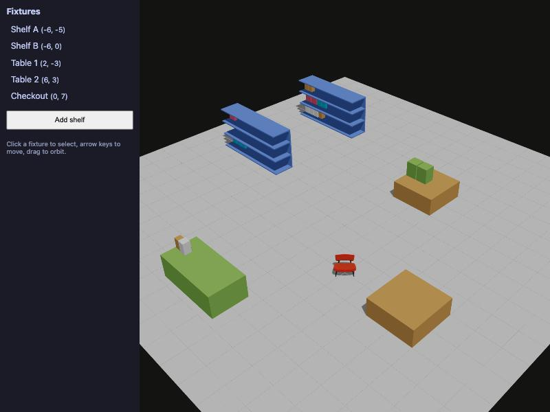

# Store Floor Planner

A tiny store floor planner built with React Three Fiber: shelves and tables on a 20x20 floor that
you can select, move with the arrow keys and add from an ordinary HTML panel. Select a fixture and
the panel turns into a small planogram editor: pick products from a catalog and they are placed as
facings on the lowest shelf level with room (width and height are checked); click a facing to remove it.
Built as a short refresher on three.js concepts.



## Run

```bash
npm install
npm run dev
```

Drag to orbit, scroll to zoom, click a fixture to select it, arrow keys move it one grid cell.
With a fixture selected, use the "+ Product" buttons in the panel to fill its shelves.

## 3D concepts it demonstrates

- **Scene graph** – `<Canvas>` is the root; every JSX element inside is a three.js object in a tree ([Scene.tsx](src/Scene.tsx)).
- **Parent/child transforms** – each fixture is a `<group>`; its planks and products are children positioned relative to it, so moving the group moves everything on the shelf ([Fixture.tsx](src/Fixture.tsx)).
- **Camera** – a perspective camera placed at a corner above the floor gives the isometric-style view.
- **Lights** – an ambient light fills the scene evenly and a directional light acts as the sun and casts shadows.
- **Mesh = geometry + material** – each fixture is a `boxGeometry` wrapped in a `meshStandardMaterial` ([Fixture.tsx](src/Fixture.tsx)).
- **Raycasting / picking** – R3F raycasts from the camera through the pointer, so `onClick` on the fixture group is all it takes to select it (events bubble from the hit product mesh up to the group); `onPointerMissed` on the canvas deselects.
- **OrbitControls** – the drei helper that turns pointer drags into camera orbit, zoom and pan.
- **Shared state between 3D and HTML** – one zustand store drives both the meshes and the plain HTML list; the planogram editor is ordinary React that writes to the same store ([store.ts](src/store.ts), [Panel.tsx](src/Panel.tsx)).
- **glTF** – a display chair (the Khronos "SheenChair" sample asset in `public/`) is loaded with `useGLTF` inside `<Suspense>` and mounted with `<primitive>` ([DisplayItem.tsx](src/DisplayItem.tsx)).
